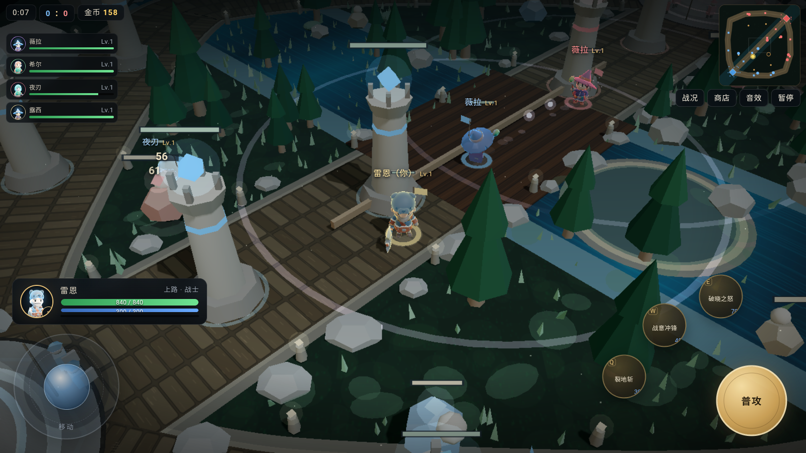
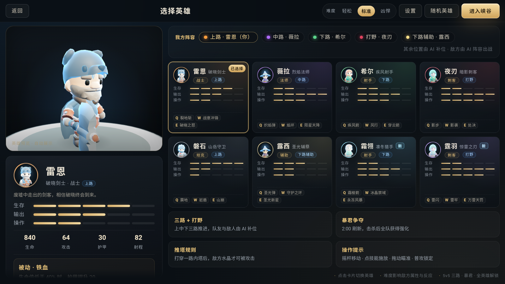
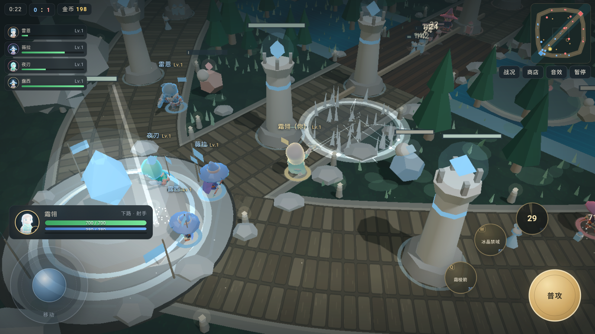
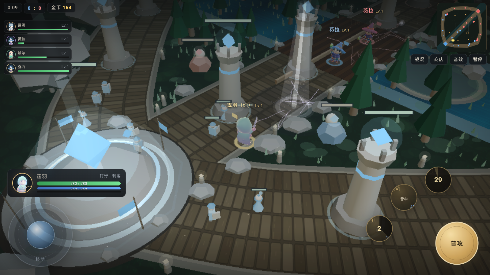
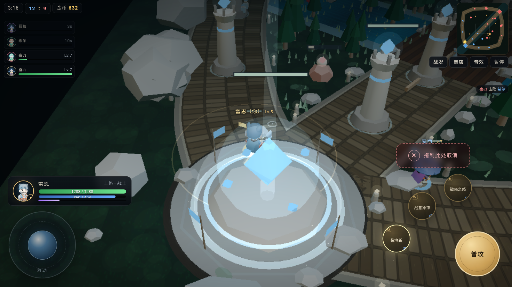
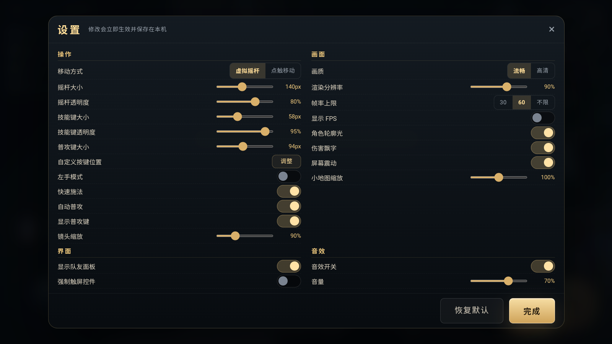
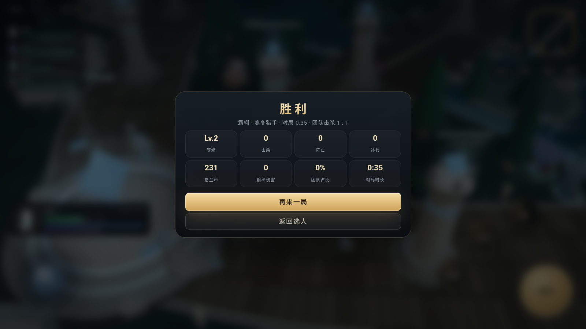

# 孤影峡谷 3D · Shadowrift Arena 3D

一个原创、完全离线、无需登录的 **5v5 3D MOBA**。Web 端基于 three.js，Android 端使用 WebView + 本地 HTTP 资源服务封装。

> 本项目不是《王者荣耀》或任何商业游戏的修改版，不包含其代码、角色形象、美术或音频素材。玩法参考通用 MOBA 规则。

**最新版本：v1.5** · 8 名原创英雄 · 画面/动画升级 · 三路 + 野区 · 触控操作 · 技能拖拽取消

[下载最新 APK](https://github.com/zgr007/shadowrift-arena3d/releases/latest) · [查看 Release v1.5](https://github.com/zgr007/shadowrift-arena3d/releases/tag/v1.5)

## 特性

- **5v5 单机对局**：玩家 + 4 名 AI 队友 vs 5 名 AI 敌人，三路兵线、野区、暴君/主宰、防御塔与水晶护盾。
- **8 名原创英雄**：雷恩、薇拉、希尔、夜刃、磐石、露西、霜翎、霆羽；每人 3 个主动技能与被动。
- **完整战斗系统**：补兵、经验、等级、金币、商店、装备、冷却、法力、眩晕/减速/护盾、复活与难度选择。
- **王者式触控**：左下摇杆，右下 Q/W/E 弧形技能轮盘 + 大号普攻；拖动瞄准、快速施法、自动普攻、左手模式。
- **技能取消**：拖动技能后进入右上“拖到此处取消”区域松手，立即中断施法，不扣蓝、不进冷却；支持左手布局、Esc 与 Android 返回键取消。
- **自定义布局**：设置内可拖动调整摇杆、技能区和普攻键位置；支持大小、透明度、镜头缩放、渲染分辨率、角色轮廓光、帧率上限等 24 项设置。
- **画面升级**：角色轮廓光、软阴影、电影感暗角；冰晶改为分面晶体，闪电增加分支，天雷光柱增加冲击环；支持高清阴影与渲染分辨率调节。
- **动画反馈**：玩家登场光柱与缩放、阵亡灵魂、重生光柱、脚步尘土、冲刺落地、施法爆发、受击镜头震动，以及护盾/队旗动态。
- **技能特效**：程序化冰晶、闪电、天雷光柱、陨星、地面裂纹、焦痕、瞄准线、弹道拖尾与屏幕闪光。
- **角色立绘**：运行时从 CC0 低模实时渲染，不依赖网络图片；用于选人卡、HUD、队友栏和计分板。
- **完全离线**：不需要账号或网络服务；Android 仅使用 loopback 本地服务器加载 APK 内资源。

## 截图



| 英雄选择 | 霜翎 · 永冻风暴 |
| --- | --- |
|  |  |

| 霆羽 · 万雷天罚 | 拖拽取消施法 |
| --- | --- |
|  |  |

| 设置 | 结算 |
| --- | --- |
|  |  |

## 操作

| 操作 | 手机 | 桌面 |
| --- | --- | --- |
| 移动 | 左下虚拟摇杆 | 鼠标点击地面 |
| 普攻 | 右下“普攻” | 鼠标点击敌人 / 自动普攻 |
| 技能 | Q/W/E 按钮点按或拖动 | Q / W / E |
| 取消施法 | 拖动技能到“拖到此处取消”松手 | 拖拽中按 Esc |
| 商店 | 顶部“商店” | B |
| 计分板 | 顶部“战况” | Tab |
| 暂停 | 顶部“暂停” | Esc |

## 目录结构

```
v3/                         Web 游戏源码（three.js）
  assets/models/            CC0 KayKit 角色模型
  css/ js/ vendor/          样式、逻辑、three.js
  index.html
  server.js                 本地静态资源服务（端口 8133）
android/                    Android WebView 工程
  app/src/main/assets/www/  APK 内嵌的 Web 资源
  app/src/main/java/...     WebView + 本地回环 HTTP 服务
docs/screenshots/           README 截图
```

## 本地运行 Web 版

需要 Node.js：

```bash
cd v3
node server.js
```

打开 <http://127.0.0.1:8133>。也可以使用任意静态 HTTP 服务器托管 `v3/` 目录；不要直接双击 `index.html`，因为 GLB 资源需要通过 HTTP 加载。

## 构建 Android APK

环境：JDK 17、Android SDK 34、Gradle 8.9。

Web 改动后，先把资源同步到 Android 工程：

```bash
cp v3/index.html android/app/src/main/assets/www/
cp v3/css/*.css android/app/src/main/assets/www/css/
cp v3/js/*.js android/app/src/main/assets/www/js/
cp v3/CREDITS.txt android/app/src/main/assets/www/
```

构建 debug APK：

```bash
cd android
gradle :app:assembleDebug
```

输出：`android/app/build/outputs/apk/debug/app-debug.apk`。

当前 Release APK 使用 debug 签名，适合 sideload / 测试，不用于应用商店发布。

## 许可证与素材

- 本项目原创代码：MIT，详见 [LICENSE](LICENSE)。
- 角色模型/动画：KayKit Character Pack – Adventurers，CC0，详见 [v3/assets/models/LICENSE-kaykit.txt](v3/assets/models/LICENSE-kaykit.txt)。
- three.js：MIT。
- 技能特效视觉思路参考 `LinearAbiltyCastingThreeJS`（MIT），分面冰晶几何移植并适配自该项目，其余效果为独立重写；完整说明见 [v3/CREDITS.txt](v3/CREDITS.txt)。

## 免责声明

本项目为个人学习与娱乐用途的原创独立游戏，与腾讯、《王者荣耀》及其他商业 MOBA 产品无关联。项目不包含任何商业游戏的素材；请勿将本项目用于冒充官方产品或商业发行。
